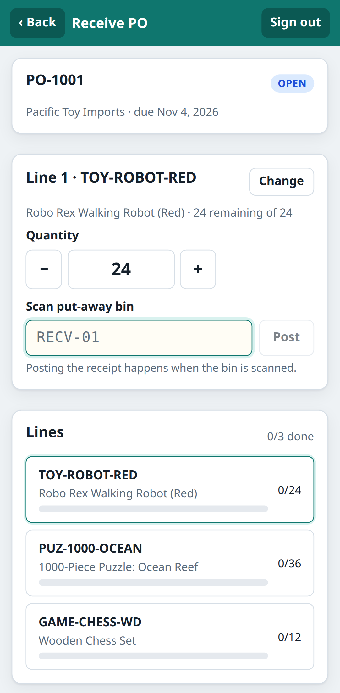
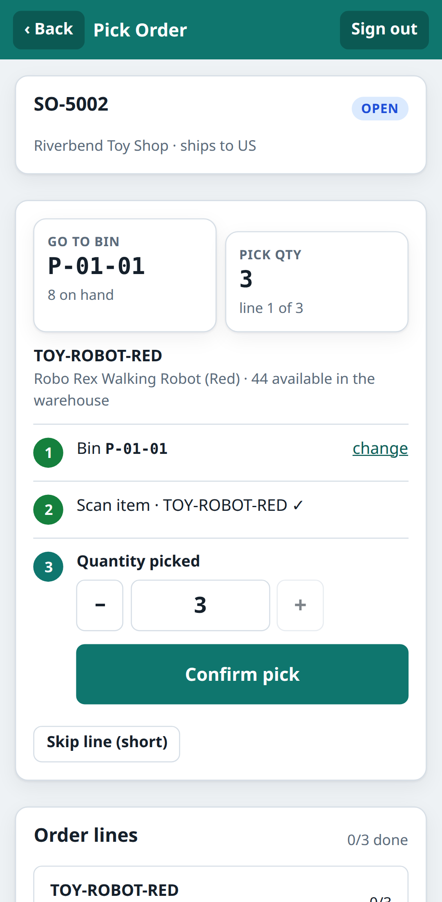
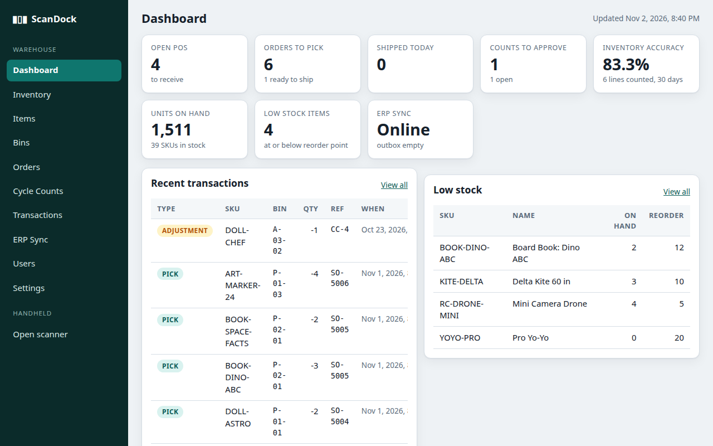

# ScanDock WMS

A small, complete **warehouse management system** built to practise end-to-end QA automation: a handheld
barcode-scanning app (receiving, picking, shipping, bin transfers, cycle counts, inquiry, labels), an admin console,
a REST API on Postgres, and a mock ERP it synchronises with. Think of it as a toy cousin of products like RF-SMART,
Oracle WMS or NetSuite WMS: the warehouse floor talks to scanners, the scanners talk to the ERP.

Everything is TypeScript, runs in Docker, and is covered by **~250 Playwright tests** (API, handheld UI, console UI,
journeys, accessibility, visual, cross-browser smoke, resilience) plus a Postman/Newman collection, Jasmine/Vitest unit tests, k6 and CI.

> Built in one sitting as interview preparation for a QA Engineer role. The app is deliberately modest; the
> **testing** is the point. Start with [docs/TEST-PLAN.md](docs/TEST-PLAN.md) and [e2e/](e2e/).

<p>



</p>

## Quick start

```bash
# prerequisites: Docker with compose v2 (Node 22+ only for local dev / running Playwright on the host)
npm install
npm run up                 # builds and starts db, erp-mock, api, web -> http://localhost:5180
```

Sign in with `picker1` / `1234` (operator, lands on the handheld) or `admin` / `1234` (admin console).
Other demo users: `super` (supervisor), `receiver1` (operator), `inactive` (deactivated). The ERP mock has a status page at
http://localhost:4100.

Try a flow: **Receive** → scan `PO-1001` → scan `041234000015` (Robo Rex Red) → scan bin `RECV-01`. Then open the console,
**Inventory**, search `TOY-ROBOT-RED`.

```bash
npm run test:unit          # Jasmine (API rules) + Vitest (web client)
npm run test:e2e           # Playwright against the running stack (host browsers)
npm run test:e2e:docker    # the same inside the official Playwright image (what CI runs; also visual tests)
npm run test:e2e:smoke     # just the @smoke tests
npm run test:postman       # the Postman collection through Newman (postman/README.md)
npm run traceability       # rebuild docs/TRACEABILITY.md from test tags
npm run down               # stop and wipe the database
```

Local development with hot reload (Postgres still in Docker): `npm run dev`, then http://127.0.0.1:5180.

## What is in the box

| Path | What |
|---|---|
| `apps/web` | React 19 + Vite SPA. `/scan/*` is the handheld (phone-sized, scan + Enter), `/admin/*` the console. Plain CSS, no UI framework. |
| `apps/api` | Fastify 5 + Postgres. Items, bins, inventory ledger, POs/receipts, SOs/picks/shipments, transfers, cycle counts, users, settings, ERP sync + outbox. |
| `apps/erp-mock` | "Nimbus ERP", an Express stand-in for NetSuite: orders originate here, receipts/fulfillments/adjustments are posted back, `/erp/_chaos` simulates outages. |
| `e2e` | Playwright: config with 10 projects, fixtures, data factory, page objects, ~250 tests. |
| `postman` | Postman v2.1 collection (74 requests, ~350 assertions) + environment, generated by `scripts/build-postman.ts`; runs in CI through Newman. |
| `perf` | k6 smoke script. |
| `docs` | [Architecture](docs/ARCHITECTURE.md) · [Requirements](docs/REQUIREMENTS.md) · [Test plan](docs/TEST-PLAN.md) · [Traceability](docs/TRACEABILITY.md) · [Bug reports](docs/BUG-REPORTS.md) · [RF-SMART research](docs/RF-SMART-RESEARCH.md) · [Interview prep](docs/INTERVIEW-PREP.md) |
| `.github/workflows/ci.yml` | Lint, typecheck, unit tests, build, traceability gate, Playwright in 3 shards inside Docker, merged HTML + JUnit (X-ray) report, manual k6 job. |

## The test suite at a glance

```
e2e/
  playwright.config.ts   projects: setup · api · scanner-mobile (Pixel 7) · admin-desktop · journeys · a11y · visual · smoke-firefox · smoke-webkit · serial
  support/               fixtures (api, apiAs, erp, factory, loginAs), API client, data factory, global setup (waits for health, resets the DB), auth setup (storageState per role)
  pages/                 page objects: login, handheld screens, console screens
  tests/api              124 black-box API tests: auth, RBAC matrix, items, bins, inventory, receiving, picking, shipping, transfers, cycle counts, ERP sync, users, labels, reports, zod contracts, settings
  tests/scanner           66 handheld tests on a phone profile: every workflow, wrong scans, lot handling, steppers, status screens
  tests/admin             ~30 console tests: filters in the URL, pagination, modals + validation, approvals, sync
  tests/journeys           3 end-to-end business flows across roles, UI and the ERP mock
  tests/a11y               axe-core WCAG 2.1 A/AA on 25 screens + dialog semantics
  tests/visual             screenshot baselines (Docker image only)
  tests/smoke              critical path in Firefox and WebKit
  tests/serial             settings that change behaviour for everyone, ERP outage / retry / latency (runs last, one at a time)
```

Design choices worth noticing (details in the [test plan](docs/TEST-PLAN.md)):

* **Data is created per test through the public API** (`Factory`), with unique codes, so the whole suite runs in parallel on one database and the seed is only used read-only.
* **Act in the UI, assert through the API** (and vice versa): fast, unambiguous, and it tests the integration for free.
* **Role-based `storageState`** from a `setup` project; API clients per role for the RBAC matrix.
* **Retrying assertions only**; tests touching global state are quarantined in the `serial` project.
* **Requirement tags** (`@REQ-009`) on every test feed a generated [traceability matrix](docs/TRACEABILITY.md); CI fails if a requirement has no test.
* **Resilience is tested**, not assumed: ERP down, slow, failing once; two pickers racing for the last unit; concurrent syncs.
* The suite found and documented three real bugs in the app while it was being built: see [docs/BUG-REPORTS.md](docs/BUG-REPORTS.md).

## API in one screen

```
POST /api/auth/login {username,pin}      GET /api/auth/me
GET  /api/items?q&lowStock&page          GET /api/items/:skuOrBarcode        POST/PATCH /api/items
GET  /api/bins?zone                      GET /api/bins/:code                 POST/PATCH /api/bins
GET  /api/inventory?sku&bin&zone&lowStock  GET /api/inventory/item/:key  GET /api/inventory/bin/:code  GET /api/inventory/invariants
GET  /api/purchase-orders?status&open&q  GET /api/purchase-orders/:po        POST /api/purchase-orders
POST /api/purchase-orders/:po/receipts {lines:[{lineNo|sku, qty, bin, lot?}]}   POST /api/purchase-orders/:po/close
GET  /api/sales-orders?pickable&shippable GET /api/sales-orders/:so (suggestions, shipping suggestion)  POST /api/sales-orders
POST /api/sales-orders/:so/picks {lineNo,bin,qty,lot?,sku?}  POST …/complete-pick {shortReason?}  POST …/ship {weightLb?,carrier?}  POST …/cancel
GET  /api/shipping/suggest?weightLb&country&priority
POST /api/transfers {sku,fromBin,toBin,qty,lot?}            GET /api/transfers
GET  /api/cycle-counts?status&assignedTo=me  POST /api/cycle-counts {bin,assignedTo?}  GET /api/cycle-counts/:id
POST /api/cycle-counts/:id/submit {lines:[{sku,lot?,countedQty}]}  POST …/approve  POST …/reject
GET  /api/users  POST /api/users  PATCH /api/users/:id         GET/PATCH /api/settings
GET  /api/erp/status  POST /api/erp/sync  GET /api/erp/log  GET /api/erp/outbox
GET  /api/labels/bin/:code  GET /api/labels/item/:key?lot      GET /api/reports/dashboard  GET /api/transactions
GET  /api/health                                              POST /api/test/reset (TEST_HOOKS=true only)
```

Errors: `{ "error": { "code": "OVER_RECEIPT", "message": "…", "details": {…} } }` with 400/401/403/404/409/502.

## Seed data worth knowing

Jacksonville DC (`JAX`), 41 toy-distribution SKUs with UPC-A barcodes (`041234000015` = `TOY-ROBOT-RED`), bins
`RECV-01/02`, `QA-01`, `A-01-01…A-04-04`, `B-01-01…B-02-04` (storage), `P-01-01…P-02-04` (picking), `SHIP-01/02`.
Open POs `PO-1001`, `PO-1002` (lot-tracked lines), `PO-1005`; partial `PO-1003`; sales orders `SO-5001…SO-5008` in every
status; cycle counts in every status; `KITE-DELTA`, `YOYO-PRO`, `BOOK-DINO-ABC`, `RC-DRONE-MINI` are low on stock.
The ERP mock holds `PO-2001/2002` and `SO-6001/6002` that appear after **Sync now**.

## Licence

MIT. All company, product and people names in the data are invented.
